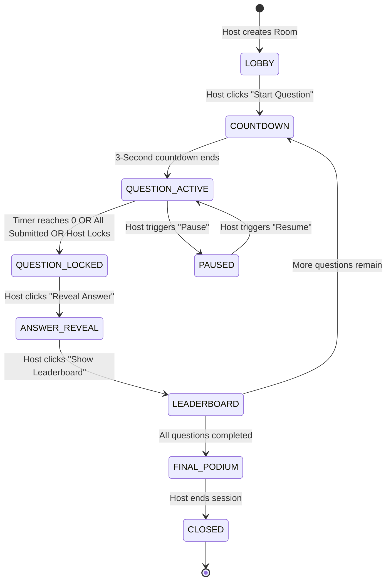

# Application & State Flow Specification (AppFlow)
## Project: LearnUp Live Arena

---

## 1. High-Level Role-Based User Journeys

The platform coordinates three distinct synchronized actors:

```
┌─────────────────┐       ┌─────────────────┐       ┌─────────────────┐
│  ADMIN / HOST   │       │ STAGE BROADCAST │       │  MOBILE PLAYER  │
└────────┬────────┘       └────────┬────────┘       └────────┬────────┘
         │                         │                         │
         │ 1. Creates Quiz & Room  │                         │
         ├────────────────────────>│ (Shows PIN & QR)        │
         │                         │                         │
         │                         │ 2. Scans QR / Enters PIN│
         │                         │<────────────────────────┤
         │                         │                         │
         │ 3. Hits "Start Quiz"    │                         │
         ├────────────────────────>│ (3s Countdown SFX)      │
         ├─────────────────────────┼────────────────────────>│
         │                         │                         │
         │ 4. Question 1 Active    │ (Shows Question & Media)│ (Shows A, B, C, D)
         │                         │                         │
         │                         │ 5. Player Submits Answer│
         │                         │<────────────────────────┤
         │                         │                         │
         │ 6. Timer Ends / Locked  │ (Locks Visual Timer)    │ ("Answer Locked")
         │                         │                         │
         │ 7. Reveal Answer        │ (Shows Correct & Chart) │ ("Correct! +940")
         │                         │                         │
         │ 8. Leaderboard View     │ (Shows Top 10 Teams)    │ (Shows "You are #4")
         │                         │                         │
         │ 9. Final Podium         │ (Confetti & Winners)    │ (Final Summary)
         ▼                         ▼                         ▼
```

---

## 2. Detailed Screen Flows

### 2.1 Admin / Host Journey
1. **Authentication & Dashboard**:
   - Admin logs into `/admin/login` using credentials.
   - Views past quizzes, analytics, and "Create New Quiz" button.
2. **Quiz Builder (`/admin/quizzes/:id/edit`)**:
   - Adds questions: Title, Options (A, B, C, D), Marks, Correct Option, Time Limit (seconds), Media Upload (Image/Audio), Negative Marking Toggle.
   - Sets quiz type: Standard MCQ, Semi-Final Buzzer, or Rapid Fire.
3. **Session Activation (`/admin/rooms/launch`)**:
   - Host selects quiz and clicks "Launch Live Room".
   - System registers new room, allocates unique 6-digit numeric PIN, and generates short URL + QR code.
   - Opens **Host Cockpit** (`/admin/rooms/:pin/control`).
4. **Lobby Orchestration**:
   - Host monitors live joining counter and list of registered teams.
   - Ability to remove/rename offending team names before start.
   - Click "Launch Competition" to begin.
5. **Question Loop Control**:
   - **Start Question**: Emits `STATE:QUESTION_ACTIVE`.
   - **Early Lock**: If all teams submit before timer expires, host can click "Lock Now".
   - **Show Reveal**: Reveals correct option and aggregate answer breakdown chart.
   - **Show Standings**: Displays current round leaderboard.
   - **Next Question**: Advances pointer `currentQuestionIndex++` and repeats.
6. **Emergency Cockpit Controls**:
   - **Pause/Resume Timer**: Freezes countdown across all screens.
   - **Disqualify Team**: Immediately kicks a socket and zeroes score.
   - **Manual Score Adjustment**: In case a question is disputed on stage.
7. **Post-Event**:
   - Exports CSV / Excel report (`/api/rooms/:pin/export`).

---

### 2.2 Contestant / Player Journey (Mobile Web)
1. **Entry (`/play`)**:
   - If user navigates to `/play`, inputs 6-digit PIN. If user scans QR code, PIN is pre-filled (`/play?pin=784920`).
   - Inputs registration fields: Team Name, Institution Name, Team Captain, Mobile Number.
   - Generates/stores `sessionToken` (UUID v4) in browser `localStorage`.
2. **Waiting Lobby**:
   - Displays: "You're in! Welcome [Team Name]".
   - Animated pulse waiting screen with sound toggle.
3. **Synchronized Question Screen**:
   - Upon host trigger, device vibrates (if supported) and displays 3-second ready countdown.
   - Question goes active:
     - Header: Question Number, Synchronized Circular Countdown Timer, Current Score.
     - Body: Question text + optional media preview thumbnail.
     - Action Area: 4 distinct color-coded tactile buttons (Red Triangle, Blue Diamond, Yellow Circle, Green Square).
4. **Submission & Lock State**:
   - Tapping an option immediately disables other buttons, pulses the selected card, and sends timestamped answer to server.
   - Screen displays: "Answer Recorded! Waiting for results...".
5. **Answer Reveal & Feedback**:
   - As host reveals answer:
     - If Correct: Green screen explosion, "+940 pts", "Speed Bonus: +240 pts", "Streak: 3 🔥".
     - If Incorrect: Soft red screen, "Incorrect! Option B was correct", "+0 pts" (or negative deduction).
     - Individual Rank Badge: "Current Position: #6 of 133 Teams".
6. **Round Completion & Final Summary**:
   - At end of round: Breakdown of total questions, accuracy %, average response time, final rank, and download digital participation summary.

---

### 2.3 Stage / Broadcast Journey (`/stage/:pin`)
1. **Cinema Display Setup**:
   - Optimized for full-screen HDMI/DisplayPort output (1920x1080 or 3840x2160) without scrollbars.
2. **Lobby Display**:
   - High-contrast giant QR code on the left half of the screen.
   - 6-digit PIN and URL `quiz.domain.com` prominently displayed.
   - Right half: Live grid of joined team cards floating in real-time.
   - Background ambient tournament music.
3. **Active Question Display**:
   - Question text displayed in extra-large readable font (min 32px - 48px).
   - High-resolution image/audio player embedded if present.
   - Large central SVG countdown ring ticking down.
   - Live counter: "98 / 133 Teams Answered".
4. **Reveal & Analytics Display**:
   - Real-time animated bar chart illustrating the percentage and count of participants who chose A, B, C, or D.
   - Correct answer card expands with a gold glowing border and checkmark.
5. **Stage Leaderboard**:
   - Shows Top 5 or Top 10 teams.
   - Animated re-ranking bars: teams slide up or down with indicator arrows.
6. **Grand Finale Podium**:
   - 3rd, 2nd, and 1st place podium animation with confetti cannons and victory fanfare audio.

---

## 3. Finite State Machine (FSM) Specification



### State Definitions & Payload Constraints

| State Name | Allowed Host Actions | Allowed Player Actions | Broadcast Behavior |
| :--- | :--- | :--- | :--- |
| `LOBBY` | Kick player, start game, edit settings | Join room, edit profile | Display QR, PIN, player ticker |
| `COUNTDOWN` | Cancel countdown | None (Ready screen) | 3... 2... 1... sound & visual |
| `QUESTION_ACTIVE` | Early lock, pause timer, skip | Select 1 option (once) | Show question, media, timer, answers received |
| `QUESTION_LOCKED` | Reveal answer | None (Viewing locked state) | Show "Time Up" animation |
| `ANSWER_REVEAL` | Show leaderboard, adjust marks | View individual result | Show answer distribution chart & correct answer |
| `LEADERBOARD` | Next question, finish quiz | View personal rank & delta | Show Top 10 animated leaderboard |
| `FINAL_PODIUM` | Export report, close room | View final certificate | 1st, 2nd, 3rd place podium animation |
| `PAUSED` | Resume, terminate | Inputs disabled | "Competition Paused by Host" banner |

---

## 4. Special Round Flows

### 4.1 Semi-Final: Buzzer / Podium Switch Round
1. State changes to `BUZZER_ACTIVE`.
2. Admin reads or displays question on stage.
3. Player mobile screens show a single large interactive buzzer button.
4. **Buzzer Lockout Protocol**:
   - First player socket event received at server acquires the atomic lock.
   - Server immediately broadcasts `BUZZER_LOCKED: { teamId, teamName, reactionTimeMs }`.
   - All other player screens are locked out ("LOCKED OUT: Team Falcons buzzed in!").
   - Host gives verbal floor to Team Falcons.
   - Host clicks on Admin screen: `Correct (+100)` OR `Incorrect (-50 Negative Marking)`.
   - If incorrect, host can click "Pass/Reopen Buzzer" to allow remaining 5 teams to buzz.

### 4.2 Grand Finale: Rapid Fire Round
1. Finalist team takes the hot seat.
2. Host initiates 60-second master countdown timer.
3. Stream of 30 rapid questions: Host or contestant taps `Next / Pass / Submit`.
4. High-speed score tallying without intermediate reveals until the 60 seconds expire.

---

## 5. Resilience & Edge-Case Handling

### 5.1 Player Disconnection & Auto-Rejoin
1. When a player connects, `sessionToken` is stored in `localStorage`.
2. If network drops or browser refreshes, player socket emits `room:reconnect { pin, sessionToken }`.
3. Server retrieves existing player object:
   - Restores cumulative score and rank.
   - If current state is `QUESTION_ACTIVE` and player already submitted, restores `LOCKED` state.
   - If not yet submitted, syncs remaining countdown time and displays options.

### 5.2 Host Crash / Browser Reload Recovery
1. The entire room state lives in MongoDB and memory (or Redis).
2. If host closes tab or reloads, host controller re-authenticates via admin JWT and fetches `GET /api/rooms/:pin/state`.
3. Host immediately resumes controlling the room from where it was left without interrupting connected players.

### 5.3 Late Answer Submission Rejection
1. If an answer packet arrives at the server $> 1000\text{ ms}$ after `QUESTION_LOCKED`, the server returns an explicit rejection: `{ success: false, reason: "EXPIRED" }`.
2. No score is awarded for late packets, eliminating race-condition tampering.
